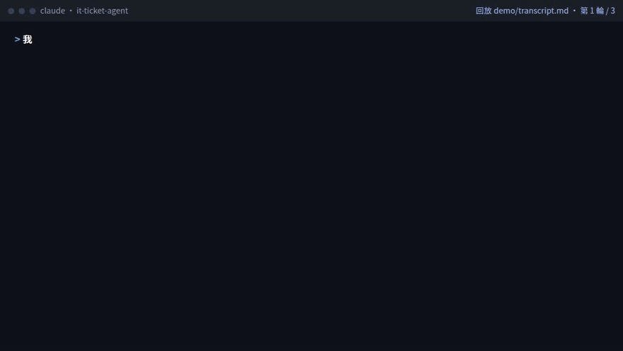
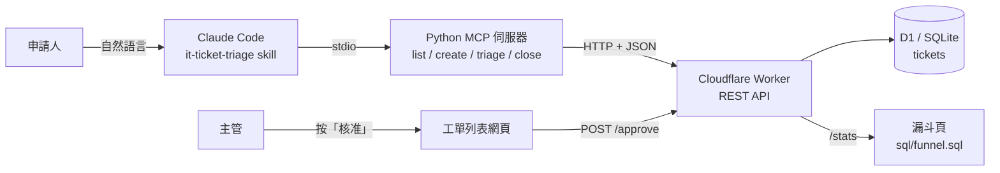

# IT 工單自動化 Agent

用一句話申請 IT 設備或權限，Agent 透過 MCP 建單、分派、結案；核准只能由人在網頁上按。



GIF 裡的終端畫面逐字回放 [demo/transcript.md](demo/transcript.md)；網頁核准那一段是在本機環境重演同一步驟，線上那次結案後的畫面見 [demo/ticket-201-closed.png](demo/ticket-201-closed.png)。

- 線上 demo：<https://it-ticket-agent.angie091120.workers.dev>（申請表單、工單列表、[漏斗數字](https://it-ticket-agent.angie091120.workers.dev/stats)）
- 完整對話紀錄：[demo/transcript.md](demo/transcript.md)
- 技術：Cloudflare Workers＋D1（TypeScript、Hono）、Python MCP 伺服器（官方 `mcp` SDK）、Claude Code skill、SQL

資料全是假的。人名由 faker 產生，部門與品項是通用名稱，沒有任何真實公司的流程或資料。

## 1. 流程盤點

假設一間中型公司的 IT 申請長這樣：員工寄信或填共用表單，IT 值班的人每天早上看一輪，自己判斷急不急、丟給誰，主管用回信核准，做完了在表單上打勾。

這個流程卡在四個地方：

| 卡點 | 現況 | 後果 |
|---|---|---|
| 分類靠人 | 值班的人讀完信才知道是設備、權限還是軟體 | 早上第一個小時都在分信 |
| 優先序看心情 | 沒有寫下來的規則 | 同樣是螢幕壞掉，有人當天處理，有人等三天 |
| 核准散在信裡 | 主管回信說「可以」 | 稽核時找不到誰核准了什麼 |
| 進度看不到 | 沒有狀態欄位 | 申請人只能一直問，也算不出平均要等多久 |

## 2. 轉成自動化需求

每個卡點對應一條需求，再對應到這個 repo 裡的東西：

| 需求 | 做法 | 位置 |
|---|---|---|
| 一句話就能申請，系統自己分類 | Agent 讀自然語言，填好類型、品項、原因再建單 | `create_ticket`、skill |
| 優先序有固定規則、可以被檢查 | 規則寫成程式，每次分派都回傳理由 | `mcp/ticket_mcp/rules.py` |
| 結案前一定要有人核准 | API 層擋：`approved_by` 是空的就回 409；Agent 沒有核准工具 | `src/index.ts`、`close_ticket` |
| 每張單都有狀態與時間戳 | 建單、分派、開始、結案各記一個時間 | `migrations/0001_init.sql` |
| 看得到瓶頸 | 四段漏斗 SQL，網頁和 SQL 檔用同一份 | `sql/funnel.sql`、`/stats` |

刻意留給人的事：核准、駁回、推翻分派規則。這三件事寫在 skill 裡，Agent 被要求時要拒絕並給出核准連結。

## 3. 架構圖



這裡有兩條規則，擋的位置不一樣：

- **沒核准就不能結案**，由 API 強制。`PATCH` 把狀態改成 `done` 或 `rejected` 時，`approved_by` 必須有值，不然回 409。檢查寫在 `UPDATE ... WHERE approved_by IS NOT NULL` 裡，兩個請求同時進來也繞不過去。
- **Agent 不能核准**，目前只擋在 Agent 這一側。MCP 只有四個工具，HTTP client 遇到 `/approve` 路徑直接拋錯；skill 寫明核准要人做；repo 的 `.claude/settings.json` 禁掉 WebFetch 和 curl 這類指令。可是 API 本身分不出呼叫的是人還是 Agent，一個開著 shell 的 Agent 還是有辦法自己打 `/approve`。正式環境要把核准放到登入後面，見「已知限制」。

REST API：

| 方法 | 路徑 | 說明 |
|---|---|---|
| `POST` | `/api/tickets` | 建單，狀態 `new` |
| `GET` | `/api/tickets?status=` | 列表，可依狀態篩選 |
| `GET` | `/api/tickets/:id` | 單張 |
| `PATCH` | `/api/tickets/:id` | 改 `priority`／`assignee`／`status`；未核准就結案回 409 |
| `POST` | `/api/tickets/:id/approve` | 網頁核准鈕呼叫，body 帶 `approver` |
| `GET` | `/api/stats` | 漏斗數字 |

## 4. PoC 驗證

[demo/transcript.md](demo/transcript.md) 是一次真實的 Claude Code 對話，三輪：

1. 「我需要一台 27 吋外接螢幕，因為現在這台一直閃爍……」→ Agent 載入 skill、建單 #201、分派給設備組，P2，理由是命中關鍵字「閃爍」。
2. 「螢幕已經裝好了，幫我結案。」→ `close_ticket` 回 `pending human approval`，資料庫狀態沒變。
3. 一位真人在網頁上按核准，接著說「主管剛剛核准了」→ 結案成功，回報核准人。

自動測試：

```bash
npm test                         # 22 條 vitest：API、409 閘門、跳脫 HTML、漏斗頁數字與 SQL 一致、demo 防濫用
cd mcp && uv run pytest          # 12 條 pytest：close_ticket 未核准不寫入、409 不誤報結案、沒有核准工具
node scripts/check-pages.mjs <網址>  # 瀏覽器檢查：390px 不橫向捲動、按核准後 approved_by 有寫入
```

兩組測試都做過反向驗證：把核准檢查拿掉之後，對應的測試會失敗。

## 5. 數字

線上 demo 在 2026-10-31 跑 `sql/funnel.sql` 的結果。資料是 200 筆種子（分布在最近 8 週）加上 demo 那張 #201：

| 階段 | 到達筆數 | 中位停留 |
|---|---|---|
| 建單 | 201 | |
| 分派 | 195 | 建單到分派 7.4 小時 |
| 開始處理 | 174 | 分派到開始 21.4 小時 |
| 結案 | 154 | 開始到結案 42 小時 |
| 駁回 | 13 | |

積壓最多的是設備類：21 張未結，其中 16 張卡在「處理中」。軟體類 8 張，權限類 5 張。

線上的數字每天重灌後會略有不同。這些是種子資料，用來證明查詢寫得出來、看得出瓶頸，不代表任何真實單位的效率。換成真實資料時，最先要看的是「分派到開始」那段：它比前一段長了將近三倍，代表單子分出去以後沒人接。

## 安裝

需要 Node 20 以上、[uv](https://docs.astral.sh/uv/)、Claude Code。

```bash
# 1. API 與網頁：本機 D1 建表、灌 200 筆假資料、起 http://localhost:8787
npm install && npm run seed && npm run dev

# 2. MCP 伺服器
cd mcp && uv sync && uv run python -m ticket_mcp.server --list-tools

# 3. 在 repo 根目錄開 Claude Code，核准 .mcp.json 裡的 it-tickets，貼上 demo 的第一句
```

`.mcp.json` 預設打本機（`http://localhost:8787`）。線上 demo 的工單誰都能寫，工單內容會原樣回到 Agent 的對話裡，所以不建議讓 Agent 直接打線上 demo；真的要打，照 transcript 的做法只開 MCP 工具、關掉 shell 和網路工具。部署到自己的帳號：`npx wrangler d1 create it-ticket-agent`，把回傳的 id 填進 `wrangler.jsonc`，再跑 `npm run seed -- --remote` 和 `npm run deploy`。

## 目錄

```
src/            Worker：REST API、三個網頁、/stats
migrations/     D1 建表
sql/funnel.sql  漏斗四段查詢（/stats 直接讀這個檔）
scripts/        種子資料產生器、瀏覽器檢查
test/           vitest
mcp/            Python MCP 伺服器與 pytest
.claude/skills/it-ticket-triage/  Claude Code skill
demo/           對話紀錄、截圖、GIF
```

## 已知限制

- 核准鈕沒有登入，任何打開網頁的人都能按，核准人名字也是自己填的，所以現在的 `approved_by` 只能當示範，不能當稽核紀錄。正式環境要把 `/approve` 和工單列表放在 SSO 後面（例如 Cloudflare Access），核准人從登入身分帶入，另外記核准時間。
- 寫入端點只收 `application/json`，核准還會檢查請求來自本站頁面，擋掉別的網站代送；這不能取代登入。
- 線上 demo 的資料任何人都能改。每天台灣時間 03:00 排程重灌一次，總筆數到 500 就不再收新單。
- API 允許開放狀態之間直接跳，例如已分派直接結案（#201 就是），所以「結案」筆數可能比「開始到結案」的樣本數多。
- `close_ticket` 的 `resolution` 只回傳到對話裡，資料表沒有這個欄位。

## 開發方式

需求拆解、程式、測試和文件都用 Claude Code 完成，我負責定規格、驗收與取捨。同一套做法在我的私人多代理系統上維護 60 餘支 Skill 與 8 支 hook。

MIT License
